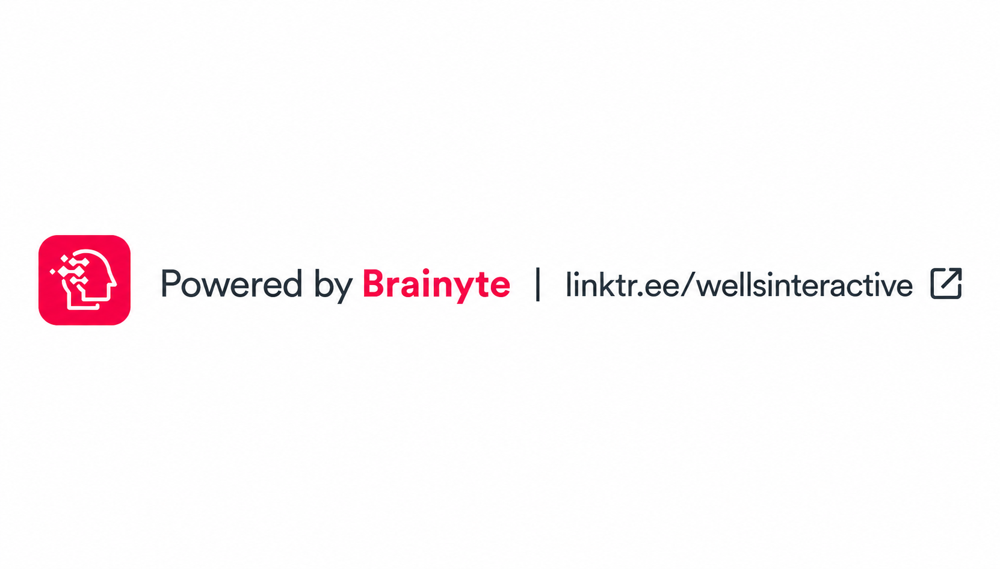
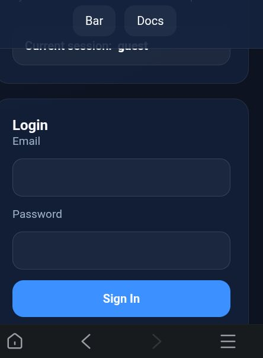
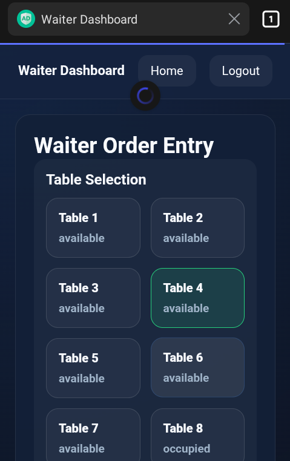
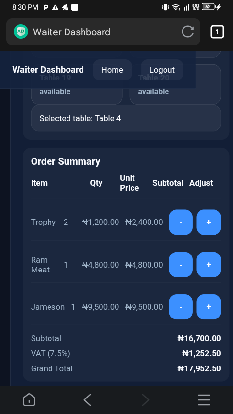
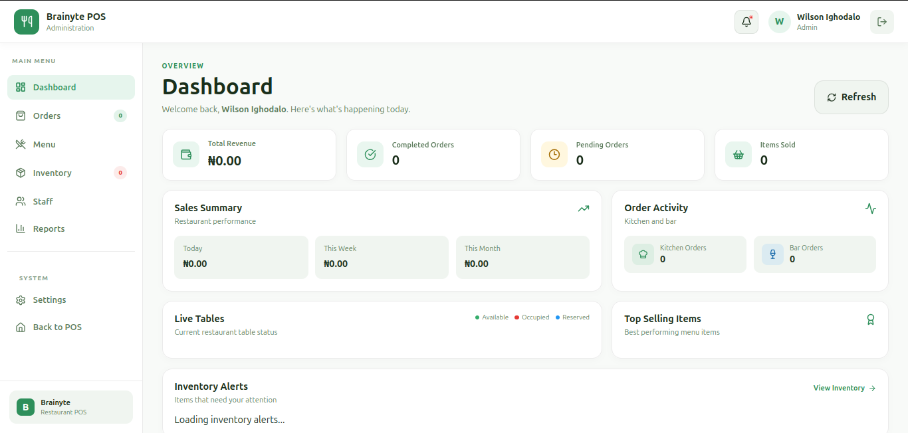
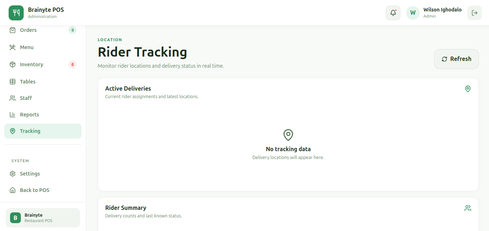

<div align="center">



# 🍽️ Brainyte Restaurant POS

### Modern Restaurant Point of Sale System for Nigerian Restaurants & Bars


**Designed & Developed by Brainyte**

https://linktr.ee/wellsinteractive

</div>

---

# 📖 Overview

Brainyte Restaurant POS is a modern restaurant ordering system built specifically for Nigerian restaurants, bars, lounges and hotels.
The system focuses on speed, simplicity and real-time communication between waiters, the kitchen and the bar.

---

# 📱 Current Screens

<div align="center">

| Login | Tables | Order Confirm | Summary |
|:------:|:------:|:----:|:-----:|
|  |  |  |  |


| Admin Dashboard
 
 


</div>

## 🌐 Live Demo

Experience Brainyte POS:

[🚀 Launch Live Demo](https://brainytepos.is-great.net)


## 🆕 New Features

- Multi-restaurant platform managed by a setup-installed Super Admin.
- Search, activate, deactivate, archive, and group restaurants into chains.
- Shared Flutter app with restaurant-scoped accounts and operations.
- Globally unique email addresses across restaurant accounts.
- Chain menu sharing with branch-specific inventory and operations.
- Menu items added at a chain branch are visible to the other branches in that chain. 
- Restaurant Owners and Admins use the same Flutter app; their accounts and operational data are scoped
to their assigned restaurant. This way every restaurant can you the app on Google play Store.


# ✨ Features


## 🔐 Authentication
✅ Login System
✅ Secure Sessions
✅  User Roles

## 📦 Inventory Management
✅ Inventory tracking per menu item
✅ Current stock levels
✅ Minimum stock levels
✅ Stock units
✅ Stock In
✅ Stock Out
✅ Manual stock adjustments
✅ Adjustment reasons and audit trail
✅ Inventory movement history
✅ Low-stock alerts
✅ Out-of-stock alerts
✅ Automatic menu availability based on stock
✅ Automatic stock deduction when orders are completed
✅ Inventory dashboard statistics

## 📊 Reporting
✅ Dashboard reporting
✅ Revenue reporting
✅ Completed order reporting
✅ Order and operational statistics
✅ Payment reporting
✅ Operations reporting
✅ Best-selling item reporting
✅ Table status reporting
✅ Date-range based reporting

---

## 🍽️ Waiter Module

- ✅ 20 Restaurant Tables
- ✅ Live Table Status
- ✅ Order Entry
- ✅ Running Order Summary
- ✅ Quantity Increase/Decrease
- ✅ Nigerian Currency (₦)
- ✅ Customer Instructions
- ✅ Order Confirmation
- ✅ One-click Send Order

---

## 🍺 Drinks Menu
All Nigerian Drinks menu but can be customized for other countries.
---

## 🍲 Food Menu
All Nigerian food menu but can be customized for other countries.

# 🍳 Kitchen Module

- Incoming Orders
- Preparing Orders
- Ready Orders
- Live Updates

---

# 🍺 Bar Module

- Incoming Orders
- Preparing Drinks
- Ready Drinks
- Live Updates

---


# 🧾 VAT

Current Version

VAT Rate

```
0%
```

(The VAT engine remains available internally and can easily be re-enabled.)

---

# 🚀 Roadmap

## ✅ Phase 1

Web Version

- Login
- Waiter
- Kitchen
- Bar
- Orders
- API

**Status:** ✔ Completed

---

## 🟡 Phase 2

Testing & Bug Fixes

- Performance Improvements
- Inventory Management (NEW - IMPLEMENTED)
- Stock Movement & Audit Trail (NEW - IMPLEMENTED)
- Low Stock & Out-of-Stock Alerts (NEW - IMPLEMENTED)
- Automatic Inventory Deduction (NEW - IMPLEMENTED)
- Supplier Management (NEW - IMPLEMENTED)
- Stock Receiving (NEW - IMPLEMENTED)
- Reporting API (NEW - IMPLEMENTED)
- Notification Management (NEW - IMPLEMENTED)
- Print Job Management (NEW - IMPLEMENTED)
- Bearer Token + Refresh Token Authentication (NEW - IMPLEMENTED)
- Token Revocation & Device Sessions (NEW - IMPLEMENTED)
- Audit Logging (NEW - IMPLEMENTED)
- Rate Limiting (NEW - IMPLEMENTED)
- Multi-Restaurant management

**Current Stage**

---


# 🛠 Technology Stack

- PHP 8
- MySQL
- JavaScript (ES6)
- HTML5
- CSS3
- REST API
- Server-Sent Events (SSE)
- REST API v1
- Bearer Token Authentication
- Refresh Token Authentication
- Firebase Cloud Messaging integration support
- Thermal / Receipt / A4 Print Job Support

---


# Branding

Powered by 

**Brainyte**

https://linktr.ee/wellsinteractive

---


# 📌 Version

```
Brainyte Restaurant POS - Current Version 2.2 Stable
```

---

<div align="center">

## ⭐ Future Vision

🌐 Web Platform

⬇

📱 Android

⬇

🍎 iOS

⬇

☁ Cloud Restaurant Management Platform

---

Developed by **Brainyte** of Wells Interactive 
Email: wellsintltd@gmail.com
website: http://www.wellsint.site

</div>


